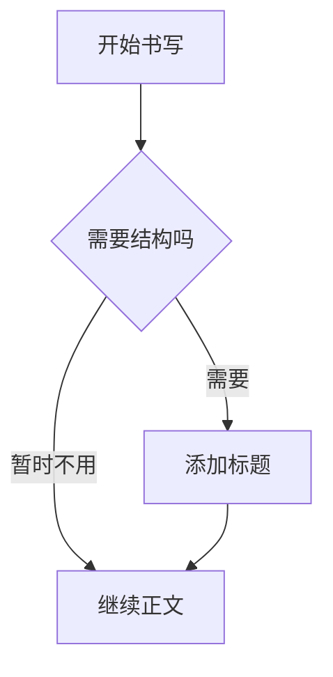
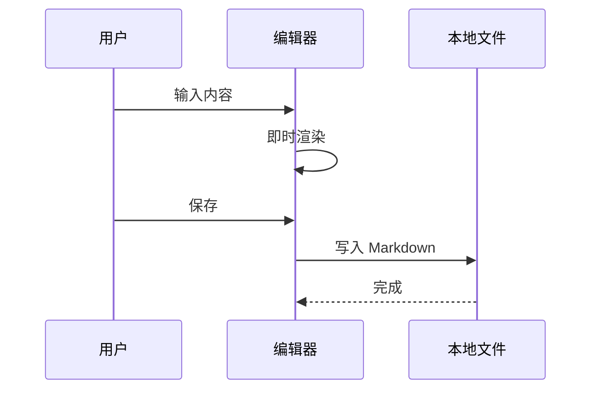
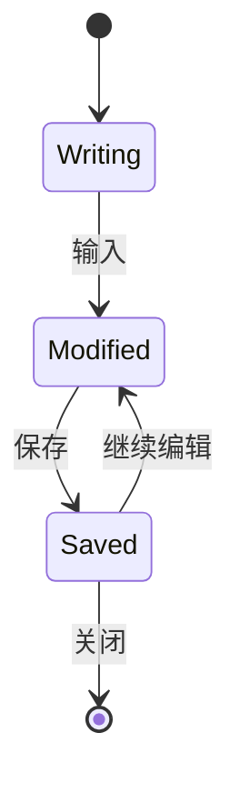
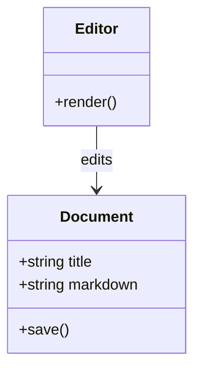
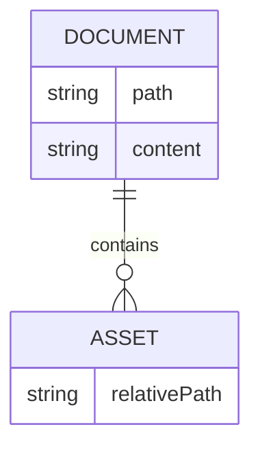
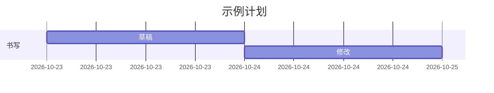
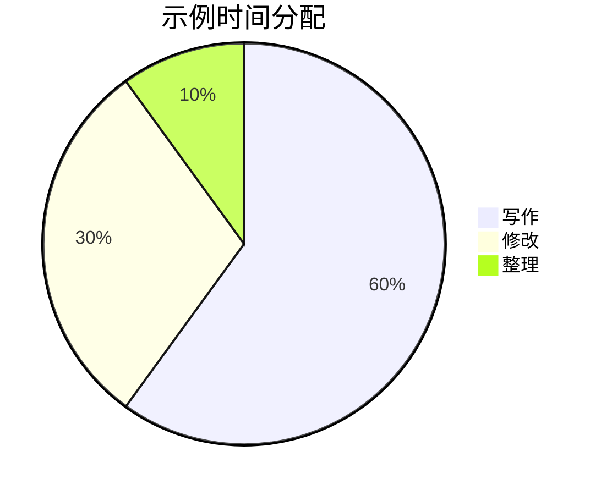
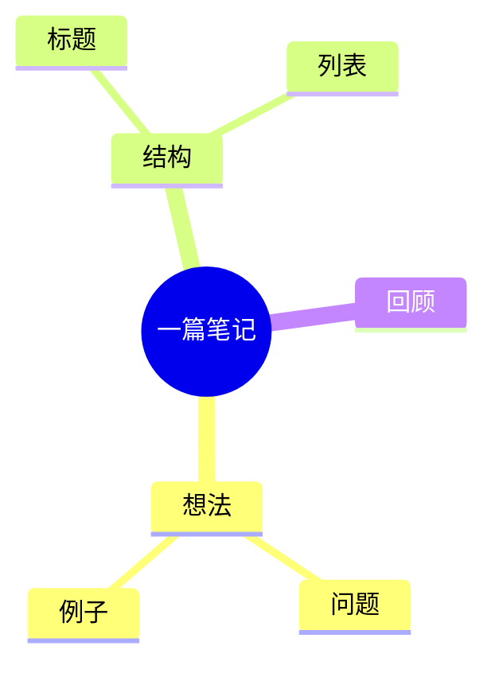

# 墨页完整语法验收

这是一份可编辑测试文档。请分别执行创建、修改、删除、撤销、源码切换与保存重开，并记录结果。保留 `assets/` 文件夹，以便验证中文和空格图片路径。

[toc]

## 一、文字与行内格式

普通中文 English 123，中文标点：“你好，世界！”；Emoji：🙂 🚴 🧑‍💻。

**粗体**、*斜体*、***粗斜体***、~~删除线~~、`inline_code("中文")`、**粗体里的 *斜体* 文字**。

==高亮文字==，水的化学式 H~2~O，平方 x^2^，HTML 下标 H<sub>2</sub>O 与上标 x<sup>2</sup>。

转义：\*不是斜体\*，\# 不是标题，\[不是链接\]，普通下划线 `game_object_name`。

这一行末尾有两个空格。  
这一行应当保持软换行。

显式 HTML 换行：第一行<br>第二行。

### 三级标题

三级标题正文。

#### 四级标题

四级标题正文。

##### 五级标题

五级标题正文。

###### 六级标题

六级标题正文。

## 二、列表与块边界

- 无序项目甲
  - 二级项目
    - 三级项目
  - 二级项目之后
- 无序项目乙，含 **粗体** 和 `代码`

1. 第一项
2. 第二项
   1. 内部第一项
   2. 内部第二项
3. 第三项

- [x] 已完成任务
- [ ] 未完成任务
  - [ ] 嵌套任务

> 第一层引用。
>
> - 引用内列表
> - 含 **强调** 的项目
>
> > 第二层引用。

> [!NOTE]
> 这是一条说明。

> [!TIP]
> 这是一条提示。

> [!IMPORTANT]
> 这是一条重要信息。

> [!WARNING]
> 这是一条警告样式测试。

> [!CAUTION]
> 这是一条注意样式测试。

---

## 三、代码

```csharp
using System;

public sealed class Note
{
    public string Title { get; set; } = "中文标题";
    public void Print() => Console.WriteLine($"**{Title}**");
}
```

```python
def greet(name: str) -> str:
    # 缩进和中文注释应完整保留
    return f"你好，{name}"

print(greet("墨页"))
```

````markdown
# 代码中的 Markdown 不应变成标题

```text
内部反引号围栏
```
````

- 带代码的列表项目：

  ```text
  list code
  中文代码内容
  ```

  代码之后仍在列表项目内。

## 四、表格

| 左对齐 | 居中 | 右对齐 |
| :--- | :---: | ---: |
| 中文单元格 | **粗体** | 123 |
| `inline code` | [文内链接](#五链接图片与脚注) | 45.67 |
| 转义竖线 \| | 第一行<br>第二行 | 0 |

## 五、链接、图片与脚注

[普通链接](https://example.com "链接标题")、[引用式链接][example]、[返回顶部](#墨页完整语法验收)。

自动链接：<https://example.com>。

这句话有一个脚注[^note]，这句话引用另一个脚注[^second]，再次引用同一脚注[^note]。


HTML 指定宽度：


[example]: https://example.com "引用式链接标题"

[^note]: 这是脚注内容，含 **强调** 和 `行内代码`。

[^second]: 第二个脚注，用来验证跳转与编号更新。

## 六、公式

行内公式：$E=mc^2$，求和 $S_n = \sum_{i=1}^{n} i = \frac{n(n+1)}{2}$。

$$
\int_0^1 x^2\,dx = \frac{1}{3}
$$

$$
\begin{aligned}
a^2+b^2 &= c^2 \\
f(x) &= \frac{1}{\sqrt{2\pi}}e^{-x^2/2}
\end{aligned}
$$

$$
A = \begin{pmatrix} 1 & 2 \\ 3 & 4 \end{pmatrix}
$$

公式之后的普通中文必须可编辑。可临时把 `\frac` 改成无效命令，验证错误可见、源码保留并可修正；测试后撤销。

## 七、Mermaid

### 流程图



### 时序图



### 状态图



### 类图



### 实体关系图



### 甘特图



### 饼图



### 思维导图



图表之后的正文必须能够继续输入。可临时输入一段无效 Mermaid，检查错误不会阻断编辑，修正后可恢复图表。

## 八、HTML 与往返保存

<u>下划线文字</u>，<kbd>Ctrl</kbd> + <kbd>S</kbd>，<span style="color: #55754e">彩色文字样本</span>。

<details>
<summary>点击展开说明</summary>
<p>折叠区中的中文内容。此处用于检查常用 HTML 的显示和源码往返。</p>
</details>

HTML 注释应在源码中保留：

<!-- 墨页源码保留测试：中文、空格、数字 123。 -->

未知标签保留样本（不要求渲染出自定义组件）：

<moye-custom data-note="preserve">保留这段原始内容</moye-custom>

## 九、连续操作验收

请在本段中输入中文、添加 **粗体**、跨段落选中、删除，再连续撤销和重做。切换源码模式三次，保存并重新打开，比较内容。

不要仅检查页面是否好看：光标、选区、剪贴板、未完成语法、保存字节与真实中文输入法都需要独立验收。
